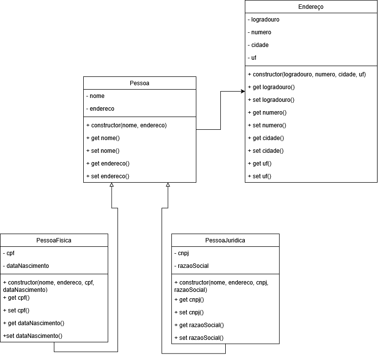

# Cadastro de Clientes - POO

**Estudante:** Álvaro Matheus Batista Paz  
**Curso:** Desenvolvedor Mobile - SENAI  
**Unidade Curricular:** Programação Orientada a Objetos  

## Sobre o Projeto

Atividade avaliativa de modelagem e implementação orientada a objetos em JavaScript para o módulo de cadastro de clientes (Pessoa Física e Pessoa Jurídica) da empresa Electronic.

O projeto utiliza herança (`extends` e `super`), encapsulamento com atributos privados (`#`), `getters` e `setters`, além de validações de dados e tratamento de erros com `throw`, `try` e `catch`.

## Diagrama de Classes

O diagrama foi feito no Draw.io (`Diagrama.drawio`) seguindo o modelo da atividade:



## Como Executar

1. Certifique-se de ter o Node.js instalado.
2. No terminal, dentro da pasta do projeto, execute:

```bash
node index.js
```

## Evidências de Teste

Foram testados quatro cenários no arquivo `index.js`:
1. Pessoa física válida
2. Pessoa jurídica válida
3. Pessoa física inválida (CPF com menos de 11 dígitos)
4. Pessoa jurídica inválida (razão social em branco)

### Saída do Terminal

```text
Cadastro realizado com sucesso: Álvaro Paz
Cadastro realizado com sucesso: Electronic
Erro ao cadastrar pessoa física: O CPF deve ter 11 dígitos.
Erro ao cadastrar pessoa jurídica: A razão social é obrigatória.

--- Clientes Cadastrados ---
Nome: Álvaro Paz
CPF: 12345678901
Data de Nascimento: 1998-05-15
Endereço: Rua das Flores, 120 - Natal/RN
----------------------------
Nome: Electronic
CNPJ: 12345678000199
Razão Social: Electronic Comercio de Eletronicos Ltda
Endereço: Av. Salgado Filho, 1500 - Natal/RN
----------------------------
```
